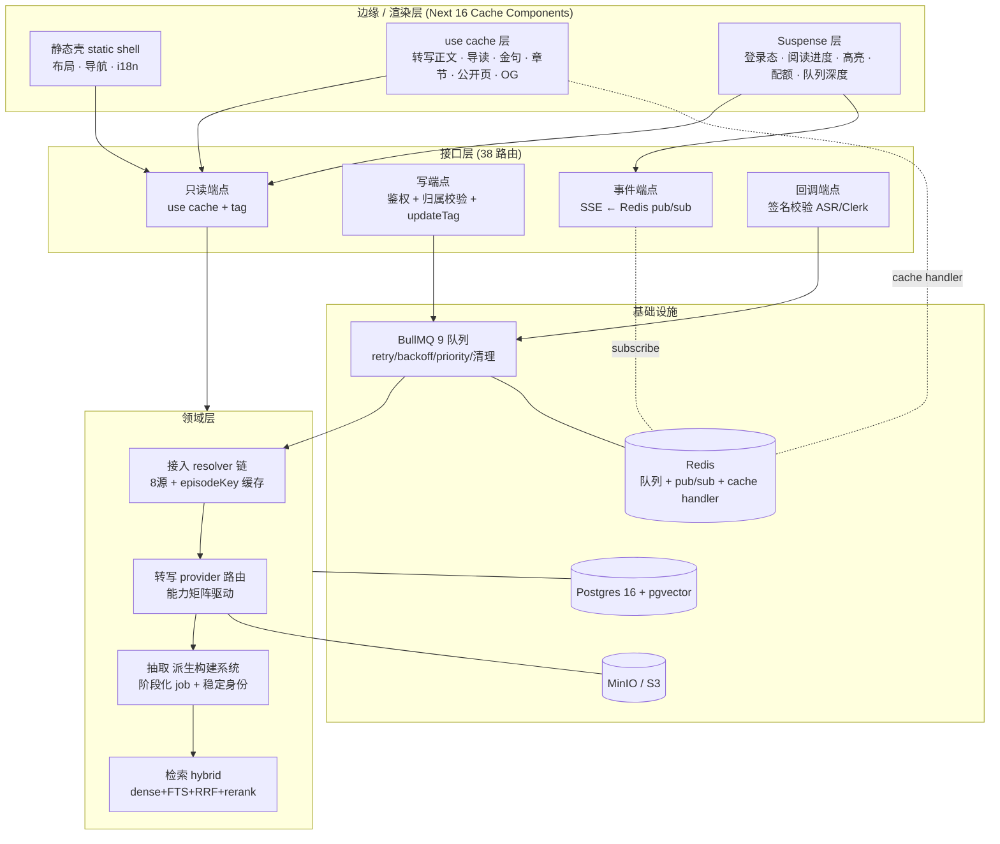
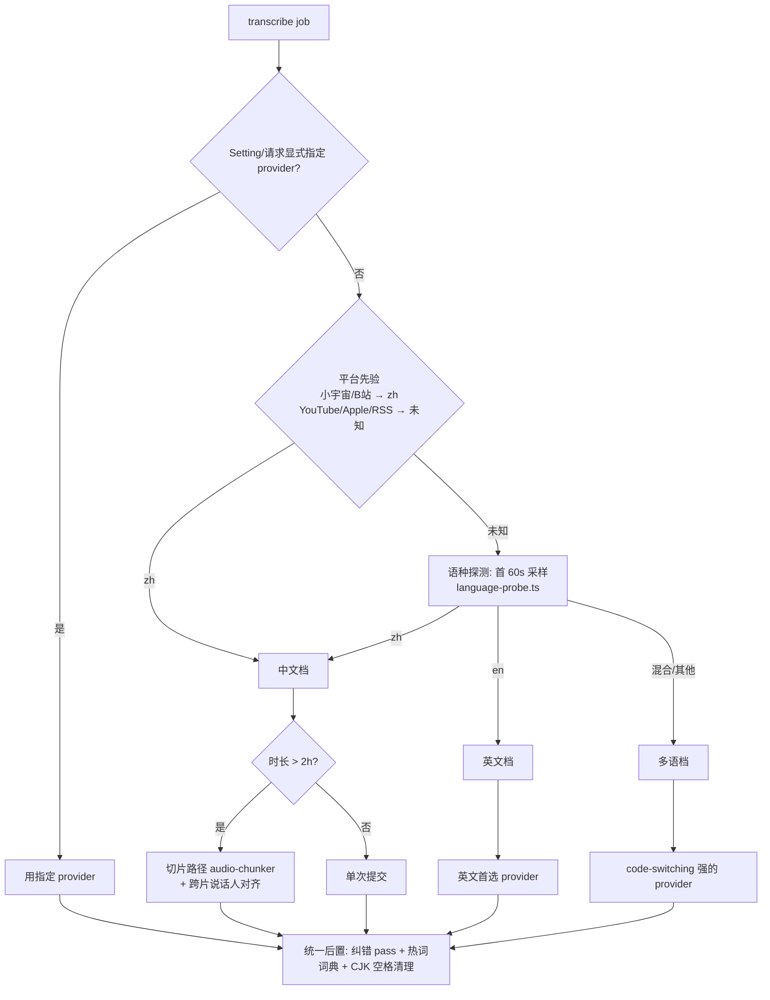
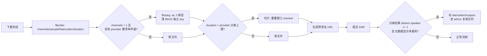
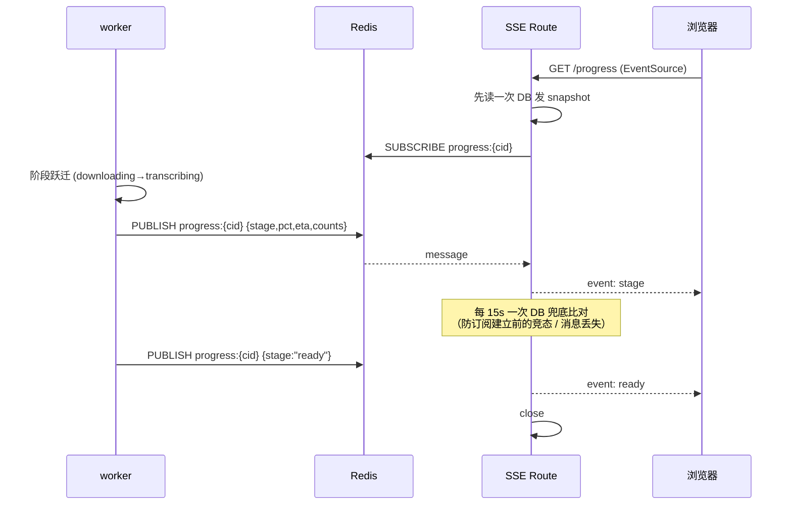
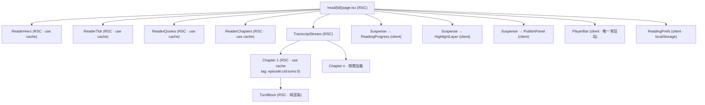

# NanoSparks 迭代方案 v5 — 技术架构详设

> 日期：2026-08-13 · 性质：**架构方案，不含实现代码**
> 基线：v4 产品方案（`iteration-plan-2026-08-production.md`）+ 架构约束（`architecture-2026-08.zh.md`）
> 本文所有"现状"均为 2026-08-13 本机实测；未能实测项已显式标注。
> 阅读顺序：§0 判断 → §1 现状 → §2 目标架构 → §3–§9 六条主轴详设 → §10 接口全表 → §11 前端 → §12–§16 横切面 → §17 交付

---

## 0. 判断

**产能过剩，验证为零，且有三处结构性断裂 + 五个 P0 缺陷在吃掉已建成能力的收益。**

47,928 行手写代码、51 个 API 路由、833 个通过单测、tsc/lint 全绿。同时：0 个外部用户、0 次真实链接端到端验证、e2e 全部 9 个 spec 合计 122 行。**缺的不是功能，是让功能真正生效的那几处接线。**

五个 P0（全部为本次实测发现，非文档引用）：

| # | 缺陷 | 实测证据 | 后果 |
|---|---|---|---|
| **P0-1** | `reprocess` / `reextract` 两个**烧钱的 POST 端点零鉴权** | 两文件均无 `auth()` 调用；`turns`/`progress`/`export` 同样无鉴权 | 任一登录用户可对任意 conversation 触发全管线重跑。成本放大攻击 + 横向越权 |
| **P0-2** | **队列全局无重试策略** | 全库 grep `attempts`/`backoff`/`removeOnComplete` = **0 命中** | BullMQ 默认 `attempts:1`。一次网络抖动 = 一集永久失败（靠 watchdog 粗粒度捞）。且 completed job 永不清理，Redis 无界增长 |
| **P0-3** | **立体声静默降级为单说话人** | 全库无 `-ac 1` 降混；百炼文档明写 diarization **仅支持单声道**，多声道全部标同一 speaker | 播客 enclosure 大量是立体声。说话人分离——产品的核心差异化——在这些集上静默失效 |
| **P0-4** | **公开页被登录墙关死** | `proxy.ts` 白名单只有 `/sign-in`、`/sign-up`、`/api/health`、`/api/webhooks/*` | C1 全套（`/p/[slug]` + sitemap + schema.org + 百度/Google 推送）建成但爬虫拿到 302。获客引擎收益恒为 0 |
| **P0-5** | **无 git remote** | `git remote -v` 空；30 项未提交（含 Clerk/admin/flags 全部工作） | 全部资产单点。CI 配置存在但从未运行过 |

两条已被外部世界推翻的 v4 决策：

- **ADR#2（paraformer-v2 作中文默认）**：阿里百炼官方文档现明写"Paraformer 是较早一代的 ASR 模型…建议迁移到 Fun-ASR 或 Qwen-ASR"。代码默认值 `BAILIAN_ASR_MODEL || 'paraformer-v2'` 停在过期型号。
- **英文走 Deepgram**：2026 批处理价格带下移到 $0.15–0.22/音频小时且多含 diarization；Deepgram Nova-3 批处理 ~$0.46/h **且 diarization 另收 $0.0020/min**——在我们唯一的用法（离线批量）上是全场最贵。其护城河（流式 <300ms）我们一次都用不到。

---

## 1. 现状实测（As-Is）

### 1.1 工程指标

| 维度 | 实测值 |
|---|---|
| 手写代码 | **47,928 行**（lib 22,275 / tests 10,549 / app 8,127 / components 6,657 / 其他 320） |
| Prisma 生成物 | 73,373 行（总 121,301 的 60%） |
| 数据模型 | 41 model/enum，778 行 schema，19 migration |
| API 路由 | 51 个 `route.ts` |
| 页面路由 | 22 个 `page.tsx` |
| 客户端组件 | 50 / 87 `.tsx`（**57%**） |
| 单测 | **833 passed / 8 skipped**，105 文件，26.4s |
| 类型检查 | `tsc --noEmit` **exit 0** |
| E2E | 9 spec / **122 行**，纯可达性 smoke |
| CI | type-check + lint + test（带 pg/redis service）— **从未运行**（无 remote） |
| 最大文件 | `analyze.ts` 1,325 行 · `ReaderShell.tsx` 1,024 行(client) · `SubmitBox.tsx` 623 行 |
| `force-dynamic` | **17 处** |
| `use cache`/`cacheLife`/`cacheTag` | **0 处** |
| `isFlagOn` 调用点 | **4 处**（注册表 20 条旗标） |
| 手工修复/验证脚本 | `scripts/` 46 文件，其中 18 个 `backfill-*`/`fix-*`/`verify-p*`/`re*-conversation` |

**未能实测**：Docker 未运行（pg:15158 / redis:16688 / dev:7557 全 closed）→ 无法读取面基 101 集的实际归属率、embedding 覆盖率、单集实测成本。**§16 的所有成本数字仍是估算**，批次 0 的第一件事就是把它们变成实测。

### 1.2 已建成资产（可复用，不推倒）

管线（BullMQ FlowProducer + 8 worker + watchdog）· 8 源 resolver 链 + 全局转写缓存 · 5 ASR provider + 切片/跨片对齐/纠错 pass/热词 · 阅读器全套（TL;DR/金句/章节/聚段/seek/双语/高亮/进度/导出）· hybrid search（pgvector + FTS + RRF + rerank + 图扩展，bge-m3 1024d）· 人物栈（SpeakerIdentity/PersonClaim/Fingerprint/trust 乘积/零引文拒答/rebuild 单一入口）· 分发（satori+resvg 卡片/三平台文案/敏感词/AIGC XMP/公众号 API）· 运营（Clerk+邀请码+admin+护栏+配额）。

### 1.3 缺陷全表

| # | 缺陷 | 证据 | 级别 | 主轴 |
|---|---|---|---|---|
| D1 | 公开页在登录墙后 | `proxy.ts:8` | P0 | §3 |
| D2 | 零缓存 / 17× force-dynamic | grep | P0 | §3 |
| D3 | reprocess/reextract 零鉴权 | 文件无 `auth()` | P0 | §10.4 |
| D4 | 队列无 attempts/backoff/清理 | grep = 0 | P0 | §7 |
| D5 | 立体声静默降级 | 无 `-ac 1` | P0 | §5.3 |
| D6 | 无 git remote | `git remote -v` | P0 | §17 |
| D7 | flags 4/20 有执行点 | grep `isFlagOn` | P1 | §14 |
| D8 | ASR 默认型号过期 + 语言路由未接线 | `paraformer.ts:49`；`factory.ts` 未调用 `isChineseSource` | P1 | §5 |
| D9 | dashboard 无界查询 | `LIST_LIMIT=200` 定义但 `findMany` 无 `take`，每行带 `_count` 关联子查询 | P1 | §11.5 |
| D10 | 派生系统仍是脚本文明 | 18 个手工脚本 | P1 | §6.4 |
| D11 | 观测是自欺 | `observability.ts` 手写 shim；package.json 无 otel/langfuse/sentry | P1 | §12 |
| D12 | Pro 优先级是死签名 | `addIngestJob(data, opts?: {pro})` 内注释"Priority disabled"，opts 未使用 | P2 | §7.3 |
| D13 | SSE 轮询 DB | `progress/route.ts` 每 2s 查一次，上限 30min = 900 次/用户 | P2 | §7.4 |
| D14 | 巨型文件 | analyze 1325 / ReaderShell 1024 | P2 | §6.2 §11.2 |
| D15 | 冻结区一月零执行 | 07-27 点名 8 域，路由与页面全在 | P1 | §10.2 |
| D16 | FlowProducer 树与实际链路存疑 | `flow.ts` 20 行注释描述倒置树；07-26 审计记录"真正工作的是 transcribe→addAnalyzeJob 直连" | P1 | §7.1 |

---

## 2. 目标架构总览

**四条设计法则（新功能必须过）**

1. **主脊测试**（沿用 07-27）：功能落在"提交 → 归属 → 阅读 → 人物"哪一段？答不出 = 冻结区。
2. **缓存三分法**：每块 UI 必须显式归入 静态 / `use cache` / `Suspense` 之一。没有第四类。
3. **可追溯**：每个派生物带 provenance + 信任度，失效而非删除。
4. **成本可归因**：每次外部调用把 `provider/model/量/成本` 落库，否则不许上生产。

---

## 3. 主轴 A — 渲染与缓存架构（Next 16 Cache Components）

**为何是最高杠杆**：`use cache` 在 16.2 脱掉 `unstable_` 成为稳定 API，PPR 成为 Cache Components 下的默认渲染模型。我们跑在 16.2.10 上一行没用。这一条同时解 D1（SEO）、D2（性能）、D14 的一半（组件拆分）。

### 3.1 三分法与硬约束

| 类别 | 判定 | 我们的内容 |
|---|---|---|
| **静态** | 纯计算 / 模块常量 / 无 I/O | 布局、导航、footer、i18n 文案表、设计 token |
| **`use cache`** | 数据外生但非运行时（不依赖当前请求身份） | 已完成集的：转写正文、TL;DR、金句、章节、参与者、公开页、OG 图、sitemap |
| **`Suspense`** | 依赖 `cookies()`/`headers()`/`searchParams` 或用户身份 | 登录态、阅读进度、我的高亮、配额余量、队列深度、admin 数据 |

**五条铁律（写进 PR 模板 checklist）**

1. **cache scope 内禁止运行时 API**，且约束沿调用栈传递——被调用的 helper 读 `cookies()` 同样报 `next-request-in-use-cache`。**我们全站 `getLang((await cookies()).toString())` 会踩这条**，必须先把 `lang` 提升为显式入参（这是 A 主轴的前置改造，见 3.5）。
2. **每个 `use cache` 必须显式配 `cacheLife`**。不配则走 default profile（stale 5min / revalidate 15min）。生命周期 <5min 会被判为"短命"掉出静态壳，等于白写。
3. **缓存键 = 入参 + 闭包变量（自动推导）**。给用户私有数据打 `use cache` 而不带用户标识入参 = **把 A 的数据发给 B**。这是安全事故不是性能问题。我们的进度/高亮/配额一律走 `Suspense`，绝不进 `use cache`。
4. **短命 cache 嵌在未声明 cacheLife 的 cache 内会构建失败**。嵌套时由外向内生命周期必须单调不增。
5. **缓存键含 build id，每次部署全失效**。跨部署持久化需 `use cache: remote` + cache handler。我们自托管且 Redis 已在栈内 → 配 Redis cache handler，无新增基础设施。

**构建期陷阱**：若 build 卡住 50s 后报 `Filling a cache during prerender timed out`，症状是把 cache 边界**外**创建的运行时 Promise（params/searchParams/cookies 来源）透过 props 或闭包传进了 cache scope。排查方向固定，写进 runbook。

### 3.2 cacheTag 命名空间（发明一次，全局遵守）

| tag 形态 | 覆盖内容 | 失效触发点 |
|---|---|---|
| `episode:{conversationId}` | 该集的正文、TL;DR、金句、章节、参与者、OG | 重转写、重抽取、说话人改名、翻译写入 |
| `episode:{cid}:turns:{chapterIdx}` | 单章节转写（细粒度） | 该章 Turn 变更（说话人改名只失效受影响章） |
| `slug:{publicSlug}` | 公开页 | 同 `episode:*` + 公开状态变更 + 下架 |
| `person:{entityId}` | 人物档案页 | claim 提升、指纹重建、身份合并 |
| `corpus:{corpusId}:graph` | 图谱 / atlas / trends | 新集入库、project job 完成 |
| `sitemap` | sitemap.xml | 新集公开、集下架 |
| `flags` | 旗标驱动的 UI 分支 | admin 改旗标 |

**失效矩阵**（写操作 → 必须调用的 tag 更新；这张表就是 review 的核对表）

| 写操作 | `updateTag`（读己所写，Server Action） | `revalidateTag`（后台换新，可延迟） |
|---|---|---|
| PATCH participant（改说话人名） | `episode:{cid}` | `person:{eid}`、`corpus:{cid}:graph` |
| POST translate 完成 | `episode:{cid}` | — |
| analyze job 完成（TU/金句/章节就绪） | — | `episode:{cid}`、`corpus:*:graph` |
| 转写完成（status→transcribed） | — | `episode:{cid}` |
| 集公开 / 生成 slug | `slug:{slug}` | `sitemap` |
| takedown 下架 | `slug:{slug}`、`episode:{cid}` | `sitemap` |
| admin 改 flag | `flags` | — |
| person rebuild 完成 | — | `person:{eid}` |

> `updateTag` 只能在 Server Action 内调用且立即失效（用户要马上看到自己的修改）；`revalidateTag` 可在 Route Handler 调用，走 stale-while-revalidate。**worker 不在 Next 进程内**，因此 worker 侧的失效走"worker → 内部 API（HMAC 签名）→ revalidateTag"这条路，新增端点见 §10.3。

### 3.3 逐路由处置表

| 路由 | 现状 | 目标渲染 | cacheLife | tag | 备注 |
|---|---|---|---|---|---|
| `/` | 默认 | 静态壳 + SubmitBox(client 岛) + 登录态 Suspense | — | — | |
| `/p/[slug]` | force-dynamic + 登录墙 | **`use cache`**，全静态壳 | `days` | `slug:*` | 同时改白名单（3.4） |
| `/read/[id]`（completed） | force-dynamic | 内容 `use cache`；进度/高亮/发布面板 Suspense | `max` + tag 失效 | `episode:*` | 内容不可变，靠 tag 而非 TTL |
| `/read/[id]`（processing） | 同上 | 动态 + SSE | — | — | 按 `status` 分流两条渲染路径 |
| `/share/[shareId]` | force-dynamic | `use cache` | `hours` | `share:*` | 外部流量入口 |
| `/person/[id]` | 默认 | `use cache` | `hours` | `person:*` | trust 排序结果可缓存 |
| `/dashboard` | force-dynamic | 动态（用户私有）；队列深度独立 Suspense | — | — | Redis 挂掉不拖垮页面；修 D9 分页 |
| `/admin` | force-dynamic | 动态 | — | — | |
| `/corpora/*` (4页) | force-dynamic | 降级为高级入口；graph/atlas `use cache` | `hours` | `corpus:*` | 移出主导航 |
| `/playlists/*` (2页) | force-dynamic | **删** | — | — | 旧 YouTube 时代遗留 |
| `/visualization/[episodeId]` | force-dynamic | **删页面，留组件** | — | — | 无入口 |
| `sitemap.ts` / `robots.ts` | 默认 | `use cache` | `hours` | `sitemap` | |
| `GET /api/*`（只读） | 逐请求 | 数据读取抽为 `use cache` 函数，handler 只编排 | 按端点 | 同页面 | Cache Components 下 GET handler 与页面同模型 |

**迁移方式（增量法，不许一把梭）**：
1. `cacheComponents: true`；
2. `npx @next/codemod cache-components-instant-false ./src/app` 给全部段打 `instant=false`（注意本项目是 `src/` 布局，路径传错会报 `0 ok` 而非失败）；
3. 删除全部 `dynamic`/`revalidate`/`fetchCache` 段配置；
4. **每次摘一条路由的 `instant=false`**，跟着 validation insight 走，改完跑一次 `next build && next start` 冒烟；
5. 剩余 `instant=false` 的路由进 debt 清单，不许无声留着。

**关键风险**：cache scope 内的运行时 API 错误"可能通过 `next build` 却在 `next start` 挂"。因此 CI 必须加 `build && start && 冒烟` 三段，只跑 build 不够。

### 3.4 登录墙改造（D1/P0-4）

从"默认全锁 + 4 条硬编码白名单"改为"默认全锁 + 一份显式公开清单，且清单受 flag 控制"（顺带给 D7 的第一条旗标接上执行点）。

公开清单：

| 路径 | 理由 | flag |
|---|---|---|
| `/p/(.*)` | SEO 获客引擎 | `public_podcast_pages` |
| `/share/(.*)` | 分享链接 | `public_share_links` |
| `/api/og/(.*)` | OG 图（社交平台抓取无 cookie） | 跟随 `public_podcast_pages` |
| `/sign-in(.*)`、`/sign-up(.*)` | 认证 | `registration_open` 控制 sign-up 表单 |
| `/api/health`、`/api/webhooks/(.*)` | 探活与回调 | — |
| `sitemap.xml`、`robots.txt` | 已被 matcher 的 `.*\..*` 排除 | 确认即可 |

**flag 关闭时的降级必须真实存在**：`public_podcast_pages=false` → `/p/*` 要求登录 **且** sitemap 停止输出该类 URL **且** OG 端点 404。这才叫开关有执行点。

**验证方式（进 CI）**：以 `Googlebot` / `Baiduspider` UA、无 cookie 请求 `/p/{slug}`，断言 200 且 HTML body 含正文标记；再断言全文段落不在 HTML 中（版权分层）。

### 3.5 前置改造：i18n 出 cache scope

现状 `getLang((await cookies()).toString())` 在几乎每个 page 顶层调用。Cache Components 下这是硬阻塞。

改造：
- 语言判定上移到 `layout`（或 middleware 写入 header），把 `lang` 作为**显式参数**逐层传入 cached 函数；
- 或者更彻底：走**路径前缀 `/[lang]/...`**，`lang` 变成 `params` 的一部分，天然可缓存且对 SEO 更友好（hreflang 可正确声明）。
- **推荐后者**——它同时解决"公开页的中英双版本各自可被索引"的问题，而这正是 SEO 引擎的一部分。代价是一次路由重排。

### 3.6 退出标准

- `force-dynamic` **0 处**；`instant=false` 数量入 debt 清单且 ≤3。
- `/p/{slug}` 无 cookie、Googlebot UA → 200 且含正文（e2e 断言）。
- 已完成集阅读页二次访问 **TTFB < 100ms**（本机 `next start`，`NEXT_PRIVATE_DEBUG_CACHE=1` 证明 HIT）。
- 阅读页首屏 RSC payload **< 150KB**。
- 两账号串号 e2e：A 的进度/高亮不出现在 B 的页面。

---

## 4. 主轴 B — 接入层（resolver）

现有 `Resolver` 接口（`canHandle` + `resolve` → `ResolvedEpisode`）设计正确，8 源齐备，`ResolverError` 已有 7 类分类。本轮**不重构，只补三处**。

### 4.1 错误分类 → 用户人话映射（当前缺失）

`ResolverErrorKind` 有 `login_required`/`region_restricted`/`no_audio`/`not_found`/`spotify_exclusive`/`platform_unreachable`/`unknown`，但前端只拿到 kind 码。补一张**错误 → 文案 + 可执行下一步**的表（这是 v4 §2.2 痛点 #1 的真正落实）：

| kind | 平台示例 | 用户文案 | 提供的下一步 |
|---|---|---|---|
| `spotify_exclusive` | Spotify 独占 | "Spotify 独占节目拿不到音频" | 按节目名搜同名 RSS/Apple，让用户确认是否同一节目 |
| `login_required` | B站充电 / YT 年龄门 | "这条内容需要登录才能访问" | 引导上传音频文件 / 配置 cookies |
| `region_restricted` | YT 地区限制 | "这条内容在服务器所在地区不可用" | 建议换平台链接 |
| `no_audio` | 纯视频 / 图文页 | "这个链接里没有可提取的音频" | 检查是否贴错链接 |
| `platform_unreachable` | 小宇宙风控 | "平台暂时打不开，可能是限流" | 自动重试排期 + discover-by-name 兜底 |
| `not_found` | 失效链接 | "链接指向的内容不存在了" | — |

### 4.2 缓存键的兜底路径

`episodeKey = platform:platformId`；无原生 id 时用音频 content-hash。**但 content-hash 需要先下载完整音频**——这与"缓存命中应当跳过下载"冲突。

改进：分两级键。
- **L1（乐观）**：`platform:platformId` 或 `normalized-url-hash`（规范化去掉 utm/追踪参数），ingest 前查，命中即秒开。
- **L2（确定）**：下载完成后算 `sha256(audio)` 写入 `GlobalEpisode.contentHash`，**唯一索引**。若发现与已有集同 hash（同一集在不同平台重复上传）→ 合并到已有 conversation，本次下载作废但**共享层直接复用**。
- 收益：跨平台去重（同一集的 小宇宙/Apple/RSS 三个链接指向一份转写），缓存命中率显著上升，而缓存命中率是 §16 单位经济学唯一的杠杆。

### 4.3 discover 通道

`resolvers/discover.ts` 已存在。把它接到错误路径上：resolver 失败 → 按标题在其他平台搜同名节目 → 让用户确认。这是"贴了链接不能用"这一 P0 痛点的最后一道兜底。

---

## 5. 主轴 C — 转写层（ASR）

### 5.1 provider 能力矩阵（选型的唯一依据）

选型不按"哪家便宜"，按**能力矩阵 × 内容特征**。矩阵字段固定为：

`词级时间戳 · 说话人分离 · 分离价格模型 · 热词/keyterm · Prompt 上下文 · 最大时长 · 输入方式 · 单声道要求 · 语种/方言 · code-switching · 计费口径`

2026-08 候选（价目为公开列表价，**所有 WER 数字都是厂商自测，不可作为选型依据**）：

| provider / model | 分离 | 词级时间戳 | 热词 | 最长 | 输入 | 计费口径 | 定位 |
|---|---|---|---|---|---|---|---|
| 百炼 `qwen-audio-3.0-asr-flash-filetrans` | ✅ | ✅ | ✅ 热词 + **Prompt 上下文** | 12h/2GB（开分离建议 ≤2h） | 公网 URL | 语音时长（**静音不计费**） | **中文新首选**（官方推荐替代 paraformer） |
| 百炼 `fun-asr` / `fun-asr-mtl` | ✅ | ✅ | ✅ 热词 | 12h/2GB | 公网 URL | 同上 | 中文备选 |
| 百炼 `paraformer-v2` | ✅ | ✅ | ✅ | 12h/2GB | 公网 URL | 同上 | **官方标记为"较早一代，建议迁移"** → 降为逃生 |
| AssemblyAI Universal-2 | ✅（+$0.02/h） | ✅ | ✅ keyterm | 长音频 | URL/上传 | $0.15/音频小时 | **英文新首选**，99 语种 |
| AssemblyAI Universal-3.5 Pro | ✅ | ✅ | ✅ keyterm（≤1500 词自然语言） | 长音频 | URL/上传 | $0.21/h，18 语种带 code-switching | 英文高精度档 |
| ElevenLabs Scribe v2 | ✅ 内置，**最多 48 说话人** | ✅ | ✅（+$0.05/h） | 批处理 | URL/上传 | $0.22/h | **中英夹杂候选**（多份独立评测中 code-switching 领先第二名一个身位） |
| Deepgram Nova-3 | ✅（**+$0.0020/min**） | ✅ | ✅（+$0.0013/min） | 长音频 | URL/上传 | 批 ~$0.46/h | **降为逃生通道**（批处理最贵，其流式优势我们用不到） |
| whisper.cpp + pyannote（本地） | ✅ | ✅ | — | 无限 | 本地文件 | CPU/GPU 摊销 | 隐私 / 降本路线 |

**中英夹杂是中文科技播客的常态**（"这个 embedding 的 latency 我们做 A/B test"），而这恰是各家分化最大的维度。所以 §5.5 的评测必须把它单列一档。

### 5.2 路由决策树（当前 factory 只看 key 存在与否，`isChineseSource` 从未被调用）

**必须落地的三件事**：
1. `factory.ts` 真正调用 `isChineseSource(hints)` + `language-probe`，而不是只看 env key；
2. 型号从 Setting 读（`asr.zh.model` / `asr.en.model` / `asr.mixed.model`），**默认值改掉过期型号**；
3. 每条路由决策写进 `ExtractionRun.metadata`（为什么选了这个 provider），否则质量回归时无法归因。

### 5.3 音频预处理管线（P0-3 的修法，provider 无关的公共前置）

要点：
- **原文件保留**用于播放（`MediaAsset.storageKey`），降混文件单独 key（`downmixedKey`），两者生命周期一致。
- `channels` / `sampleRate` / `downmixed` 写入 `MediaAsset`，作为 DER 回归的**分层维度**（立体声集与单声道集的 DER 必须分开统计，否则平均值掩盖问题）。
- `diarizationSuspect` 是把静默失效变成可见信号——这条比修 bug 本身更重要，因为它防的是下一个同类 bug。

### 5.4 长音频与异步回调

- **切片跨片对齐**：`audio-chunker.ts` + `speaker-realignment.ts` 已实现，但**跨片说话人对齐的 DER 从未测过**。§5.5 的 fixture 必须含一条 >2h 的集专测这条路径。
- **轮询 → 回调**：百炼查询接口默认 20 QPS（可扩到 100），官方推荐高并发用异步回调替代轮询。当前 `POLL_MAX_ATTEMPTS` 轮询在单集没问题，批量 100 集会打限流。

回调协议设计：

| 项 | 规格 |
|---|---|
| 端点 | `POST /api/webhooks/asr/[provider]` |
| 鉴权 | provider 签名头校验；**不信任 body 里的 conversationId**，用 `taskId` 反查 `AsrTask` 表 |
| 幂等 | `AsrTask(taskId unique, conversationId, provider, status, submittedAt, completedAt)`；重复回调直接 200 |
| 兜底 | 保留低频轮询（提交后 T+2min 起，每 60s，上限 30 次）。回调与轮询同时到达时靠 `AsrTask.status` 的 CAS 去重 |
| 失败 | provider 报错 → 写 `AsrTask.error` → 触发 BullMQ job 失败 → 走 §7.2 重试策略 |

> 回调不可靠是分布式常识：**回调是快路径，轮询是正确性保证**，两者都要有。

### 5.5 质量评测 harness（本主轴的真正交付物）

现在换 provider 是"换了感觉更好"——因为没有基线。`eval-der.ts` / `asr-eval.ts` 存在但无固定 fixture。

| 项 | 规格 |
|---|---|
| Fixture | 7 段 × 各 10 分钟，人工校对 ground truth（唯一手工成本，约 5–7 小时）：① 中文纯说（面基）② **中文重夹杂英文术语**（科技访谈）③ 粤语 ④ 英文双人 ⑤ 英文多人 >3 ⑥ 嘈杂/远场 ⑦ **立体声源**（专测 P0-3） |
| 长音频 | 额外 1 集 >2h 专测切片跨片对齐 |
| 指标 | CER（中文按字）· WER（英文按词）· **DER** · 说话人纯度/覆盖率 · **术语召回**（自定词表）· 时间戳对齐误差 P50/P95 · 实时率（处理时长/音频时长）· 实测单位成本 |
| 分层 | 按 fixture 类别分别出数，**禁止只报平均**（平均掩盖 code-switching 和立体声的塌陷） |
| 产出 | `docs/asr-benchmark-{date}.md`，provider × 维度矩阵 |
| 门禁 | 任何 provider/型号切换必须附表；**DER 退化 >5pp 直接否决**；术语召回退化 >10pp 否决 |

### 5.6 成本记账

每次转写把 `provider · model · audioSec · billedSec · costUsd · realtimeRatio` 写进 `ExtractionRun`。这是 §16 从估算变实测的唯一路径。**注意百炼按"语音内容时长"计费（静音不计）**，所以 `billedSec ≠ audioSec`，必须分开记两个数，否则成本模型永远对不上账。

---

## 6. 主轴 D — 抽取与派生构建系统

### 6.1 现有形态

`analyze.ts` 1,325 行，内含 7 个阶段函数：`runLlmExtraction` / `runLegacyExtraction` / `syncThoughtUnitsFromWindowedExtraction` / `assignTurnSpeakers` / `syncConversationFromAnalysis` / `syncThoughtUnitsFromAnalysis` / `enqueueGraphJobs`。整体在一个 job 里跑，**整体失败就整体重来**——2h 集的一次重跑是几块钱。

### 6.2 阶段化（不做大重构，只做搬运）

拆成独立 job，每阶段可单独重跑、单独观测、单独失败：

| job | 输入 | 输出 | 幂等键 | 重跑代价 |
|---|---|---|---|---|
| `extract.window` | Turn[] | ThoughtUnit + EntityCandidate（按 window） | `(cid, runId, windowIdx)` | 单窗口 LLM 调用 |
| `extract.merge` | 各 window 产物 | 全局去重/聚类/跨窗边 | `(cid, runId)` | 纯计算 |
| `attribute.speakers` | DiarizationSegment + Turn | Turn.participantId + confidence | `(cid, runId)` | 纯计算 |
| `entity.resolve` | EntityCandidate | Entity + EntityMention | `(cid, runId)` | 少量 LLM |
| `embed` | ThoughtUnit | 向量 | `(tuId, model)` | 便宜 |
| `graph.build` | TU + Entity | GraphNode/Edge | `(corpusId, runId)` | 纯计算 |
| `brief` | TU | TL;DR + 金句 + 章节 | `(cid, runId)` | 1–2 次 LLM |

**收益量化**：现在任一阶段失败 → 全集重跑（成本 = 全部 LLM 调用）；拆后 → 只重跑失败阶段。按 window 抽取占成本 70% 估算，失败重跑成本下降约 60–80%。这个数在批次 2 用 §5.6 的实测成本验证。

### 6.3 LLM 调用的降级链

结构化输出（`completeStructured` + zod）路子正确。补一条显式降级链（translation 模块已实现二分 batch，把这个模式提升为公共能力）：

`full batch → 二分 batch → 单条 → 标记 unverified 并保留原文`

**禁止静默丢弃**。任何被跳过的单元必须在 `ExtractionRun.metadata.skipped[]` 留痕，且质量门把它计入 unverified 而非计入通过（07-27 的"诚实质量门"原则）。

### 6.4 派生构建系统（收编 18 个手工脚本）

07-27 已定法则（稳定身份 upsert / 失效而非删除 / 过期可检测 / 回填自报）。执行层面：

| 类别 | 脚本 | 处置 |
|---|---|---|
| 一次性数据修正（已执行） | `backfill-attribution-method` · `fix-attribution-provenance` · `fix-tu-participant-consistency` · `backfill-turn-speakers` · `backfill-embeddings` | 移到 `scripts/archive/`，README 记执行日期与影响行数。**不删**（审计需要） |
| 重跑入口 | `reextract-conversation` · `renormalize-conversation` | 合并进 `rebuild.ts --stage=<name> --conversation=<id>`，单一入口 |
| 验证脚本 | `verify-p0`～`verify-p6` · `verify-person-api` · `verify-persona-chat-scope` · `verify-pipeline`（11 个） | **转 vitest integration**。它们检查的是不变量，不变量属于测试 |
| 运维工具 | `dev-*`（6）· `backup-postgres.sh` · `up.sh`/`down.sh` · `import-*` | 保留，统一加 `--help` 与 `--dry-run` |

目标：`scripts/` 主目录 46 → ≤20 个文件。

### 6.5 信任代数保持

`trust = ∏ (attribution × traceability)` 已实现且已接进 person API/UI。**不动**。只补一条：新增的 `diarizationSuspect` 集，其 attribution 因子上限压到 0.5（立体声降级产出的"单说话人"不该拿高置信）。

---

## 7. 主轴 E — 队列、作业图与实时层

### 7.1 作业图真相（D16）

`flow.ts` 用 20 行注释描述倒置树 `extract(root) ← normalize ← [transcribe ∥ diarize]`；07-26 审计记录"真正工作的是 transcribe→addAnalyzeJob 直连链"。**本次未能运行时验证**（Redis 未起）。

批次 0 强制动作：跑一次真实管线，用 BullMQ job 事件打出**实际执行顺序**，然后二选一：
- FlowProducer 树是活的 → 删 `addAnalyzeJob` 直连死代码；
- 直连链是活的 → 删 FlowProducer 或修正树，**并重写那 20 行注释**。

> 一段详尽描述着不存在行为的注释，比没有注释危险得多。

### 7.2 队列拓扑（补齐 D4 / P0-2）

**当前无任何 attempts/backoff/清理配置 = BullMQ 默认 `attempts:1`，且 completed job 永久堆积。**

目标拓扑：

| 队列 | concurrency | attempts | backoff | lock | 清理 | 优先级 |
|---|---|---|---|---|---|---|
| `ingest` | 2 | 3 | exponential 30s（网络类可重试） | 5min | complete: 100 / fail: 1000 | Pro=1, Free=5, batch=10 |
| `transcribe` | 3 | 3 | exponential 60s | 5min | 同上 | 继承 |
| `diarize` | 1 | 2 | fixed 60s | 5min | 同上 | 继承 |
| `normalize_turns` | 1 | 3 | fixed 10s（纯计算，失败多半是数据问题） | 5min | 同上 | 继承 |
| `extract.*`（拆分后） | 2（从 Setting 读） | 3 | exponential 30s + **jitter** | 5min | 同上 | 继承 |
| `embed` | 2 | 5 | exponential 10s | 1min | 同上 | 低 |
| `graph.build` / `project` | 1 | 2 | fixed | 10min | 同上 | 低 |
| `person_profile` | 1 | 2 | fixed | 5min | 同上 | 低 |
| `retention` | 1 | 1 | — | 5min | complete: 10 | 最低 |

**重试的分类原则**（写进 job 基类）：
- **可重试**：网络超时、5xx、429 限流、provider 临时错误 → 计入 attempts；
- **不可重试**：4xx 参数错、内容不可用（no_audio/region）、zod 校验永久失败 → 立即 `UnrecoverableError`，不浪费 attempts；
- **限流专属**：429 走独立的更长 backoff（分钟级）+ 全局熔断（连续 N 次 429 暂停该 provider 队列 M 分钟）。

`lockDuration: 5min` / `stalledInterval: 10min` 是 894b357 提交调优过的正确值，**保留**。

### 7.3 优先级（D12：修掉死签名）

`addIngestJob(data, opts?: {pro})` 接受 `pro` 但内部注释"Priority disabled"、参数未使用。这是最坏的一种 API——签名承诺了不存在的行为。

修法：要么真接上 BullMQ `priority`（社区版支持 `priority` 数值，越小越优先，无需 Pro 版），要么删掉参数。**建议真接上**，因为"首集体验决定激活"（v4 §2.3），而批量导入（面基 101 集）正在和交互流量抢 worker。

优先级分档：`首次用户的第一集 = 1` > `Pro = 3` > `Free = 5` > `批量导入 = 10`。

### 7.4 实时层：SSE 从轮询改事件驱动（D13）

**当前**：`/api/conversations/[id]/progress` 每 2s 查一次 Postgres，上限 30min → 单个等待用户 900 次 DB 往返。10 个并发等待用户 = 5 QPS 纯轮询。

**目标**：

**SSE 事件协议**（固定，前后端各一份类型）：

| event | payload | 时机 |
|---|---|---|
| `snapshot` | `{stage, pct, etaSec, turnCount, tuCount, startedAt}` | 连接建立立即发一次 |
| `stage` | `{stage, pct, etaSec, detail}` | 每次阶段跃迁 |
| `progress` | `{pct, turnCount, tuCount}` | 阶段内进度（如已转写 N/M 分钟） |
| `ready` | `{conversationId, readyAt}` | status → transcribed（**可读**，不等 brief） |
| `complete` | `{conversationId}` | 全管线完成 |
| `error` | `{code, message, hint, retryable}` | 失败，带人话与可执行下一步 |

**ETA 计算**：`etaSec = remainingAudioSec × 该 provider 近 20 次的实时率中位数`。"还要 4 分钟"对留存的作用比"转写中"大一个量级，而这个数我们已经有原料（`globalEpisode.durationSec` + §5.6 的 `realtimeRatio`）。

### 7.5 幂等与自愈

- 幂等键规则统一为 `{sourceId}-{step}-{runId}`（现为 `{sourceId}-{step}`，重跑会撞 jobId）。
- `pipeline-watchdog.ts` 保留，但职责收窄为**兜底**：有了 §7.2 的重试策略后，watchdog 只处理"进程崩溃导致的僵尸态"，不再是主要恢复机制。
- 新增 `AsrTask` 表后，watchdog 增加一条检查：提交超过 T 分钟且无回调无轮询结果的任务 → 重新提交。

---

## 8. 主轴 F — 检索层

现有 hybrid search（dense pgvector + Postgres FTS + RRF k=60 + cross-encoder rerank + 图扩展）设计正确，**不重构**。本轮三件小事：

1. **暴露到主脊**：Cmd+K 命令面板已存在（`CommandPalette.tsx`），但 `/api/search` 只做 ILIKE typeahead，真正的 hybrid 只在 `/corpora/[id]/query`（即将降级为高级入口）。把 hybrid 接到全局搜索的"深度搜索"档。
2. **索引核对**：`ThoughtUnit` 有 FTS tsvector GIN；`Conversation.title` / `Entity.canonicalName` 走 ILIKE 全表扫。集数上千后会慢。加 pg_trgm GIN 索引（一条 migration）。
3. **向量索引**：确认 `EmbeddingProjection` / TU 向量列是否建了 HNSW/IVFFlat 索引——**本次未能实测**（DB 未起）。批次 0 用 `EXPLAIN ANALYZE` 核对一次；1024d bge-m3 在无索引时是全表顺序扫。

---

## 9. 数据模型增量

**只加真正需要的**（不加任何社区/关注/通知相关新表——那些已存在于冻结区）：

| 表 / 字段 | 类型与约束 | 用途 | 主轴 |
|---|---|---|---|
| `MediaAsset.channels` | `Int?` | 声道数（ffprobe） | §5.3 |
| `MediaAsset.sampleRate` | `Int?` | 采样率 | §5.3 |
| `MediaAsset.downmixedKey` | `String?` | 单声道降混文件的 storage key | §5.3 |
| `GlobalEpisode.contentHash` | `String? @unique` | L2 确定性缓存键，跨平台去重 | §4.2 |
| `Conversation.diarizationSuspect` | `Boolean @default(false)` | 单说话人异常标记 | §5.3 |
| `Conversation.readyAt` | `DateTime?` | 出稿耗时的分子（P50 指标） | §2 判据 |
| `ExtractionRun.provider` / `.model` / `.billedSec` / `.audioSec` / `.realtimeRatio` | 各自类型 | 成本与性能实测 | §5.6 |
| `ExtractionRun.metadata` | `Json?` | 路由决策原因 + `skipped[]` | §5.2 §6.3 |
| **`AsrTask`** | `id · taskId @unique · provider · conversationId · status · submittedAt · completedAt · error · @@index([status, submittedAt])` | 异步回调幂等与兜底轮询 | §5.4 |
| **`ReadEvent`** | `id · userId · conversationId · maxScrollPct · dwellMs · at · @@index([conversationId, at]) · @@index([userId, at])` | **完读事件——北极星当前没有数据源** | §2 判据 |

**索引增量**：`Conversation.title` + `Entity.canonicalName` 的 pg_trgm GIN；TU 向量列的 HNSW（若缺）；`ReadEvent` 两条复合索引。

**模型债（本轮只标注不动）**：`Channel`/`Episode`/`Analysis`/`ReferenceLink` 与 `Source`/`Conversation` 双轨并存，是最大的冗余源。等 §10.2 的路由下线稳定运行一个月后再做一次清理 migration。

---

## 10. 后端接口详设

### 10.1 统一响应契约（现状不一致，必须收敛）

现有路由有的返回 `{success, data}`、有的返回裸对象、有的返回 `{success, error, kind, conversationId}`。定一份 envelope 并写进 route 模板：

| 场景 | 形状 |
|---|---|
| 成功 | `{ ok: true, data, meta? }`（`meta` 承载分页 `{cursor, hasMore, total?}`） |
| 失败 | `{ ok: false, error: { code, message, hint?, retryable? } }` |

- `code`：机器可分支的稳定枚举（`RESOLVER_SPOTIFY_EXCLUSIVE` / `QUOTA_EXCEEDED` / `GUARD_CONCURRENT` / `FORBIDDEN_NOT_OWNER` …）。
- `message`：**中文人话**，可直接展示。
- `hint`：可执行的下一步（"试试这个节目的 Apple Podcasts 链接"）。
- `retryable`：前端是否显示"重试"按钮。

迁移策略：新端点直接用新契约；老端点在批次 3 统一改，同时改前端调用方（前端调用点集中在 `SubmitBox`/`ReaderShell`/`dashboard`，可控）。

### 10.2 路由处置矩阵（51 → 38）

**保留 · 主脊（20）**

| 路由 | 方法 | 鉴权 | 缓存 | 备注 |
|---|---|---|---|---|
| `ingest` | POST | 登录 + 限流 + 护栏 + 配额 | — | 已完整 |
| `ingest/batch` | POST | 登录 + flag | — | |
| `upload` | POST | 登录 + flag | — | 上传永不入共享缓存 |
| `sources` | GET | 登录 + **归属过滤** | `use cache` per user? 否 → Suspense | |
| `sources/[id]` | GET/PATCH | 登录 + **归属校验** | — | |
| `sources/[id]/stream` | GET(SSE) | 登录 + 归属 | — | 改 Redis pub/sub |
| `conversations/[id]/turns` | GET | **登录 + 归属或公开** ⚠️当前无鉴权 | `use cache` + `episode:{cid}` | 分页已有 cursor |
| `conversations/[id]/progress` | GET(SSE) | 登录 + 归属 ⚠️当前无 | — | 改 Redis pub/sub |
| `conversations/[id]/thought-units` | GET | 公开可读（公开页需要） | `use cache` | 现注释已说明公开，保持 |
| `conversations/[id]/translate` | POST | 登录 + 归属 + 配额 | 写后 `updateTag episode:{cid}` | |
| `conversations/[id]/reading-progress` | GET/PUT | 登录（用户私有） | **绝不 cache** | |
| `conversations/[id]/highlights` | GET/POST/DELETE | 登录（用户私有） | **绝不 cache** | |
| `conversations/[id]/read` | POST | 登录 | — | 合并进 `read-events`？见 10.3 |
| `conversations/[id]/participants/[pid]` | PATCH | 登录 + **归属校验** | 写后 `updateTag episode:{cid}` | 说话人改名 |
| `conversations/[id]/reprocess` | POST | **登录 + 归属 + 护栏 + 配额** ⚠️**当前零鉴权** | — | **P0-1** |
| `conversations/[id]/reextract` | POST | **登录 + 归属 + 护栏 + 配额** ⚠️**当前零鉴权** | — | **P0-1** |
| `conversations/batch-status` | GET | 登录 + 归属过滤 | — | |
| `search` | GET | 登录 | 短 TTL | 加深度档走 hybrid |
| `person/[id]` | GET | 登录 | `use cache` + `person:{id}` | trust 排序 |
| `person/[id]/chat` | POST | 登录 + flag | — | 零引文拒答已实现 |
| `health` / `health/worker` | GET | 公开 / 内部 | — | |

**保留 · 运营（7）**：`admin/features` · `admin/users` · `admin/invite-codes` · `admin/takedown` · `settings` · `settings/test` · `webhooks/clerk`

**新增（4）** — 见 §10.3

**降级为高级入口（6，保留但移出主导航）**：`corpora/[id]/graph` · `atlas` · `query` · `query-stream` · `context-pack` · `trends`

**下线路由（代码保留，8）**：`playlists` · `playlists/[id]` · `episodes/[id]/full` · `episodes/[id]/status` · `episodes/summarize` · `discover/feed` · `discover/rSS`（顺带修掉这个大写 S 的目录笔误——直接删）· `conversations/[id]/comments`

**待定（B/C 阶段产物，保留不投入）**：`packages/[id]` · `conversations/[id]/packages` · `conversations/[id]/export` · `highlights/[id]/card` · `person/[id]/claim` · `sources/[id]/claim` · `glossary` · `docs`

### 10.3 新增端点契约

| 路由 | 方法 | 鉴权 | 请求 | 响应 | 用途 |
|---|---|---|---|---|---|
| `webhooks/asr/[provider]` | POST | provider 签名头；**不信 body 的 cid**，按 `taskId` 反查 `AsrTask` | provider 原生 payload | `200` 恒定（幂等） | ASR 异步回调（§5.4） |
| `read-events` | POST | 登录 | `{conversationId, maxScrollPct, dwellMs}` | `{ok:true}` | 完读打点，北极星数据源。用 `navigator.sendBeacon` 在 `visibilitychange` 时发 |
| `og/[type]/[id]` | GET | **公开** + 限流 | `type ∈ {episode, quote, person}` | `image/png` | OG 图，复用 satori 卡片渲染器；`use cache` + `days` |
| `internal/revalidate` | POST | **HMAC 签名**（worker ↔ web 共享密钥） | `{tags: string[]}` | `{ok:true}` | worker 不在 Next 进程内，靠此端点触发 `revalidateTag`（§3.2） |

### 10.4 鉴权模型（P0-1 的系统性修法）

**当前状态**：middleware 保证"已登录"，但**没有任何一条路由检查资源归属**。实测：`conversations/[id]/*` 一族中，`turns`/`progress`/`export`/`reprocess`/`reextract` 连 `auth()` 都没调用；调用了的（`highlights`/`translate`/`read`/`packages`）也只检查登录不检查归属。

三层模型（写成一个共享的 guard，所有路由必须过）：

| 层 | 检查 | 失败码 |
|---|---|---|
| L1 认证 | middleware 已保证 session；route 内二次取 `userId` | `401 UNAUTHORIZED` |
| L2 归属 | `conversation.corpus.workspace.clerkId === userId` **或** `conversation.isSharedCache && 只读操作` **或** `source.publicSlug != null && 只读且只读公开字段` | `403 FORBIDDEN_NOT_OWNER` |
| L3 配额/护栏 | 烧钱操作（ingest/reprocess/reextract/translate/upload）额外过 `checkIngestGuardrails` + `getMonthlyQuotaStatus` | `429 QUOTA_EXCEEDED` / `GUARD_*` |

**共享缓存的读权限设计**：`isSharedCache=true` 的 conversation 对**所有登录用户只读可见**（这是全局缓存的产品前提），但 `reprocess`/`reextract`/`participants PATCH` 这类写操作仍需归属或管理员。这条规则必须写死在 guard 里，不能靠每个路由自己判断。

**验证**：两账号 e2e——B 用户对 A 用户私有集的 5 个端点各断言 403；对共享缓存集断言读 200 / 写 403。

### 10.5 只读端点在 Cache Components 下的形态

Cache Components 下 `GET` route handler 与页面同模型：不访问运行时数据就预渲染。`use cache` **不能直接加在 `GET` 导出上**，必须由 handler 调用一个带 `use cache` 的辅助函数。

模式固定为：`handler(读运行时参数与鉴权) → 调用 cached(纯参数) → 组装响应`。鉴权永远在 cache 外，缓存的只有"给定 id 的公共数据"。

---

## 11. 前端架构详设

### 11.1 RSC / Client 边界重划

现状 50/87 组件是 `'use client'`（57%）。目标 **<30%**。判定规则：

| 情形 | 归属 |
|---|---|
| 需要 `useState`/`useEffect`/事件处理 | client，且**只包裹交互本身**，内容通过 `children` 从服务端流入 |
| 只渲染数据 | RSC，哪怕它嵌在 client 组件"里面"（`children` 传入即可） |
| 大列表（Turn / 搜索结果 / 集列表） | RSC 渲染，交互层浮在上面，通过 DOM 属性通信 |
| 依赖 `localStorage` / `window` | client 叶子 |

### 11.2 阅读器重构（D14 / D12）

**问题**：`ReaderShell.tsx` 1,024 行 client 组件，接收整包 200 个 Turn 作为 props → 这些数据被完整序列化两遍（HTML + RSC payload）。2h 集 600–1000 Turn 时是几百 KB。

**目标组件树**：

| 单元 | 类型 | 职责 | 数据 |
|---|---|---|---|
| `ReaderHero` | RSC + `use cache` | 封面/标题/时长/原链接/状态 | 集元数据 |
| `ReaderTldr` / `ReaderQuotes` / `ReaderChapters` | RSC + `use cache` | 静态内容，进静态壳 | TU |
| `TranscriptStream` | RSC | 章节编排 | 章节索引 |
| `Chapter[i]` | RSC + `use cache`（细粒度 tag） | 单章 Turn 渲染 | 该章 Turn |
| `TurnBlock` | RSC | 说话人聚段纯渲染，**不再是 client** | 单段 |
| `PlayerBar` | client（唯一常驻） | 播放/seek/进度 | **不持有 Turn 数据**，通过 `data-ms` DOM 属性定位 |
| `HighlightLayer` | client + Suspense | 划句高亮（监听 selection，不需要 Turn 数组） | 用户私有 |
| `ReadingProgress` | client + Suspense | 续读位置 | 用户私有，**绝不进 cache scope** |
| `ReadingPrefs` | client | 字号/行距/暗色 | localStorage |
| `ProcessingPanel` | client | SSE 消费 + 骨架屏 | 事件流 |

**虚拟滚动的取舍**：**不引入虚拟列表库**。按章节懒加载 + CSS `content-visibility: auto` + `contain-intrinsic-size` 是原生解，且对 SEO 与 Cmd+F 友好（虚拟列表会同时破坏这两者，而公开页正需要全文可索引）。只有实测 1000+ Turn 仍卡才升级，届时也优先细分 Chapter 而非虚拟化。

### 11.3 "第一分钟"体验（v4 §2.3 的落实核对）

链路已建成，补三处：

1. **秒级元数据卡 + ETA**：resolver 先返回封面/标题/时长（不等下载），并给出预计完成时间（`durationSec × provider 实时率中位数`）。现在只有阶段文案没有 ETA。
2. **转写完成即可读的骨架屏**：`status.ts` 已把 `transcribed` 当作 ready，但导读/金句未就绪时阅读器是空白区域而非骨架屏。补占位。
3. **离开的自由**：>5min 处理必须有站内红点 + 邮件。`notifications` 在冻结区，但**这一条是留存钩子不是社区功能**，单独捞出。Resend SMTP 已通过 Clerk 配置（`docs/auth-smtp-setup.md`），发信通道现成。

### 11.4 性能预算（写成 CI 断言）

| 页面 | RSC payload | LCP（本机 `next start`，CPU 4× 降速） | INP |
|---|---|---|---|
| `/` | < 30KB | < 1.2s | < 200ms |
| `/p/[slug]` | < 60KB | < 1.5s | < 200ms |
| `/read/[id]` 首章 | < 150KB | < 2.0s | < 200ms |
| `/dashboard` | < 80KB | < 2.0s | < 200ms |

外加：已完成集二次访问 TTFB < 100ms（cache HIT）。

### 11.5 dashboard 修复（D9）

现状：`findMany` **无 `take`**（`LIST_LIMIT=200` 定义了却没用），且每行带 `_count: {turns, thoughtUnits}` → N 个关联子查询。面基 101 集时已经是 101 次子查询，上千集时页面会挂。

修法：cursor 分页（`take: 50`）+ 计数改为单条 `groupBy` 聚合（现有 `statusCounts` 已是正确做法，照抄到 turns/TU 计数）+ 队列深度移进独立 `Suspense`（Redis 挂了不拖垮页面）。

### 11.6 移动端

阅读是移动场景，但 Playwright config 只有 chromium + firefox **桌面**。补：

- e2e 加 mobile project（375×812），关键路径（提交→等待→阅读→高亮）全走一遍；
- 触摸选区的划句高亮（移动端 selection API 行为与桌面不同，当前实现未验证）；
- **Media Session API**（锁屏/耳机控制）——"读+听"混合场景的刚需，成本极低；
- 底部迷你播放器与安全区（`env(safe-area-inset-bottom)`）。

### 11.7 设计系统

`globals.css` 160 行 + `scripts/assert-design-system.mjs` 门禁已在 `npm run verify` 里。**保持不动**——这是全库少数几个"有自动门禁的规范"，别破坏它。新增组件必须过这个断言。

---

## 12. 可观测性与成本

### 12.1 观测：停止自欺（D11）

`observability.ts` 是手写 span 类，`end()` 里 `logger.info`；package.json **无 otel / langfuse / sentry 任何依赖**。这不是"优雅降级"，是一个假装自己是 OTel 的日志包装器——它让人以为有链路追踪。

二选一，不许骑墙：

- **选项 1（采纳）**：**承认它是结构化计时日志**，改名 `timing.ts`，删掉全部 OTel/Langfuse 注释与 env 说明。真正需要的三个数直接落库并做一个 admin 页读它们：单集出稿耗时 · 单集成本 · 每阶段失败率。**零新依赖。**
- 选项 2：真接 OTel SDK + Langfuse collector。收益是 LLM 调用级 prompt/cost/latency 追踪，代价是 2 个新依赖 + 一个 collector 进程。**单人 + 10 用户阶段是过度投资。**

升级触发条件写明：当"哪个 prompt 花了多少钱"成为每周必答问题时，再上选项 2。

### 12.2 成本仪表（admin 新页，复用现有框架）

四张图，直接决定 §16 定价是否成立：

1. 单集成本分布（P50 / P90 / 最贵 10 集，可下钻到 ExtractionRun）；
2. 按阶段拆解（ASR / LLM 抽取 / embedding / 翻译），带 `billedSec` vs `audioSec` 对比（百炼静音不计费）；
3. 缓存命中率趋势（`GlobalEpisode.readCount` vs 首转次数）；
4. 熔断与限流触发记录。

### 12.3 健康检查

`health` / `health/worker` 已有。补三项探针：Redis 可达 · Postgres 可达 + 迁移版本 · 各队列 waiting/active/failed 深度。让 `/health` 返回结构化状态而非 200/500 二值。

---

## 13. 安全与合规

| 项 | 现状 | 动作 |
|---|---|---|
| **横向越权** | 无任何归属校验（P0-1） | §10.4 三层 guard，两账号 e2e 断言 |
| **成本放大** | `reprocess`/`reextract` 零鉴权且烧钱 | 归属 + 护栏 + 配额三重 |
| 密钥 | `.env` + `ENCRYPTION_MASTER_KEY` 加密 Setting；`.env` 已在 `.gitignore`（**已核实**） | 建 remote 前再扫一遍历史提交 |
| Prompt 注入 | `prompt-sanitize.ts` 存在，被 windowed-extraction 调用 | 逐一核查所有把用户/转写内容拼进 prompt 的位置：persona-chat · translation · 文案生成 · correction-pass |
| Webhook | Clerk webhook 有签名校验 | 新增 ASR 回调同样校验；`internal/revalidate` 用 HMAC |
| 限流 | `rate-limit.ts` 存在 | **公开路由（`/p/*`、`/api/og/*`）必须进限流**——公开后是新攻击面 |
| SSRF | resolver 接受任意 URL 并发起请求 | 加内网地址黑名单（127/10/172.16/192.168/169.254/::1）+ 重定向跟随上限 + 响应大小熔断（`RESOLVER_MAX_DIRECT_BYTES` 已有，确认覆盖所有 resolver） |
| AI 标识 | XMP 隐式标识已实现 | B 阶段前过一遍《标识办法》清单（v4 §8 不变） |
| 版权 | 分层策略不变 | 公开前把下架流程（`takedown` API 已有但**无入口**）与用户协议挂到页脚 |
| **git remote** | **无** | **P0：先建私有仓库**。CI 从未运行过这个事实本身就是缺失的连锁代价 |

---

## 14. 功能旗标（D7：从装饰变成控制面）

20 条注册，4 条有执行点。规则：**每条旗标必须有至少一个执行点 + 一条断言它生效的测试**，否则不许留在注册表里。

执行点分三类：

| 类型 | 位置 | 例 |
|---|---|---|
| 路由级 | middleware / route guard | `public_podcast_pages` 控制白名单；`registration_open` 控制 sign-up |
| 管线级 | job 入口 | `pipeline.translate.enabled`、`pipeline.extract.enabled` |
| UI 级 | RSC 读旗标决定渲染分支（`use cache` + tag `flags`） | 发布面板、人物 chat、社区入口 |

**旗标读取的缓存**：旗标读 DB 每请求一次太重。走 `use cache` + `cacheLife('minutes')` + `cacheTag('flags')`，admin 改动时 `updateTag('flags')` 立即失效。

---

## 15. 测试与质量门

### 15.1 现状

833 单测（健康）· 122 行 e2e（名存实亡）· CI 从未运行。

### 15.2 目标金字塔

| 层 | 现状 | 目标 | 内容 |
|---|---|---|---|
| 单元 | 833 | 保持 + 吸收 11 个 verify 脚本 | 纯函数、resolver、trust、chunker、状态机 |
| 集成 | 少量 | **+30**（由 verify 脚本转化） | 带真 DB：归属不变量、rebuild 幂等、配额、护栏、缓存命中 |
| E2E | 122 行 smoke | **关键路径 6 条 + mobile project** | ①提交→等待→阅读 ②缓存命中秒开 ③两账号越权 403 ④爬虫可读公开页 ⑤说话人改名→缓存失效 ⑥划句高亮→金句卡 |
| 质量回归 | 无 | **ASR benchmark**（§5.5） | 分层 CER/WER/DER/术语召回 |
| 性能 | 无 | 预算断言（§11.4） | payload 大小 + LCP + TTFB |

### 15.3 CI 流水线（补齐）

现有：type-check · lint · test（带 pg/redis service）。补：

`build` → **`next start` 冒烟**（Cache Components 的运行时错误只在 start 阶段暴露，只跑 build 不够）→ `verify:design` → `assert-i18n` → e2e（含 mobile）→ 性能预算断言。

---

## 16. 单位经济学（等实测替换）

v4 §7 的数字是估算。变实测的路径在批次 0.3（生产数据实况）与 2.5（成本记账）。

已知的外部价格变化（会改写模型）：

| 项 | v4 假设 | 2026-08 可选 |
|---|---|---|
| 中文 ASR+分离 | paraformer-v2 ~¥0.5–0.9 / 1.5h | `qwen-audio-3.0-asr-flash-filetrans`（型号更新；语音时长计费、静音不计费口径不变；**需实测核价**） |
| 英文 ASR+分离 | Deepgram ~$0.3–0.4 / 1.5h | AssemblyAI Universal-2 $0.15/h + diarization $0.02/h → 1.5h 约 **$0.26**（较 Deepgram 路线降约 1/3） |
| LLM 加工 | ~¥0.3–0.5 | 不变（多端点 profile 已可切换）；§6.2 拆阶段后失败重跑成本降 60–80% |
| 翻译 | ~¥0.3–0.6 | 不变 |
| **缓存命中率** | 假设 30–50% | §4.2 的 L2 contentHash 跨平台去重会显著抬高——这是唯一的结构性杠杆 |

定价结论暂不变（Free 4 集/月首转 + 缓存命中不占额度；Pro ¥29/月）。**在批次 0.3 的实测数出来前，任何定价讨论都是空转。**

**竞品定价校准（2026-08 实测）**：Podwise Free / $5.90（20集）/ $11.90（50 credit）/ **$299 团队版含"公开集无限处理"**——最后这档直接验证了我们全局缓存的经济学假设；Snipd $6.99–9.99（**iOS only，无 Android**）；PodWire $16–42（**邮件推送模型**）。

---

## 17. 交付计划

严格串行，每批带可证伪的验收数字。批次不完成不开下一批。

### 批次 0 — 止血（2–3 天）

| # | 事项 | 验收 |
|---|---|---|
| 0.1 | 建 git remote，推全部分支 | `git push` 成功，CI **首次运行**并绿 |
| 0.2 | 提交 30 项未跟踪改动（Clerk/admin/flags/webhook） | 工作树干净 |
| 0.3 | 起 docker 栈，打出**生产数据实况**：集数 / Turn / TU / 归属率 / embedding 覆盖 / 向量索引 `EXPLAIN` / 单集实测成本 | 数字表进 `docs/`；§16 估算被实测替换 |
| 0.4 | 验证作业图真实链路（§7.1），删死代码或重写注释 | job 事件日志证明执行顺序 |
| 0.5 | **P0-1 鉴权**：三层 guard + 全路由核对 | 两账号 e2e：5 个端点 403；共享缓存集读 200 写 403 |
| 0.6 | **P0-2 队列策略**：attempts/backoff/清理/不可重试分类 | 注入网络故障，job 自动重试成功；Redis job 数不再单调增长 |
| 0.7 | **P0-3 立体声降混** + `diarizationSuspect` 告警 | 立体声样本 diarization 正确；异常样本进复核队列 |
| 0.8 | **D9 dashboard 分页** | 200 集下页面 < 500ms |

### 批次 1 — 打开缓存与 SEO（1–1.5 周）★ 最高杠杆

| # | 事项 | 验收 |
|---|---|---|
| 1.1 | i18n 出 cache scope（`/[lang]` 路由前缀，§3.5） | 全库 cache scope 内 0 处运行时 API |
| 1.2 | 开 `cacheComponents` + codemod + 逐路由摘 `instant=false` | `force-dynamic` 0 处；`instant=false` ≤3 且入 debt 清单 |
| 1.3 | **P0-4 登录墙白名单 + flag 联动**（§3.4） | Googlebot UA 无 cookie 读到 `/p/{slug}` 正文（e2e）；flag 关闭时降级正确 |
| 1.4 | cacheTag 体系 + 失效矩阵 + Redis cache handler + `internal/revalidate` | 说话人改名后阅读页立即更新（e2e）；已完成集二次访问 TTFB < 100ms |
| 1.5 | ReaderShell 拆分（§11.2） | 首章 RSC payload < 150KB；client 组件占比 < 30% |
| 1.6 | CI 补 `build && start` 冒烟 + 性能预算断言 | 流水线全绿 |

### 批次 2 — ASR 换代与质量基线（1.5–2 周）

| # | 事项 | 验收 |
|---|---|---|
| 2.1 | ASR 评测 harness + 7 段 fixture 人工 ground truth | benchmark 表入库，分层出数 |
| 2.2 | 语言路由真接线（§5.2 决策树） | 混合语料样本路由正确率 100%；决策原因入 `ExtractionRun.metadata` |
| 2.3 | 按 harness 结果切换中文/英文默认 provider | 中文 CER 与 DER **不退化**且成本下降；术语召回不退化 |
| 2.4 | `AsrTask` + 回调替代轮询 + 兜底轮询（§5.4） | 100 集批量提交无限流告警；杀掉回调仍能靠轮询完成 |
| 2.5 | 成本记账落库 + admin 成本页（§12.2） | 单集成本 P50 有实测值；`billedSec/audioSec` 比值可见 |
| 2.6 | `analyze.ts` 阶段拆 job（§6.2） | 单阶段可独立重跑；失败重跑成本下降（用 2.5 的数验证） |

### 批次 3 — 留存引擎与收敛（1.5–2 周）

| # | 事项 | 验收 |
|---|---|---|
| 3.1 | **关注节目 → 新集自动处理 → 邮件/站内推送**（从冻结区捞 Follow + digest） | 关注 3 个节目，新集发布后 30min 内收到通知 |
| 3.2 | `ReadEvent` 完读打点 + 北极星看板 | 周完读集数有真实数字 |
| 3.3 | SSE 改 Redis pub/sub + ETA（§7.4） | 等待期 DB 查询量 −90%；ETA 误差 < 30% |
| 3.4 | 队列优先级真接上（§7.3） | 批量导入进行中提交新集，新集先完成 |
| 3.5 | 冻结区执行（§10.2）：路由 51→≤38，删 4 页面 | 路由数达标；`npm run verify` 全绿 |
| 3.6 | 脚本收编（§6.4）：11 个 verify 转 integration test | `scripts/` 主目录 ≤20 文件 |
| 3.7 | 统一响应契约（§10.1）+ 错误人话映射（§4.1） | 6 类 resolver 错误各有文案与下一步（e2e） |
| 3.8 | 移动端走查 + Media Session（§11.6） | mobile e2e project 通过 |
| 3.9 | 旗标全接执行点（§14） | 20/20 旗标各有执行点 + 断言 |

### 批次 4 — 放人进来（1 周 + 持续）

| # | 事项 | 验收 |
|---|---|---|
| 4.1 | HK VPS 部署（v4 §A4 决策不变）+ **从备份恢复演练一次** | 恢复成功 |
| 4.2 | 10 条真实链接端到端（小宇宙×3 / YouTube×2 / Apple×2 / RSS×1 / B站×1 / mp3×1） | 全部 10min 内出带说话人全文 |
| 4.3 | 用户协议 / 隐私 / 下架入口挂页脚 | 三个链接可达；takedown 有真实入口 |
| 4.4 | **邀请 10 个真实外部用户** | **判据：10 人各完读 ≥1 集；首集 P50 出稿 < 10min；4 周后 D7 ≥ 2 人** |

**本轮明确不做**：图文分发投入 · 社区 · 人物北极星（留出集预测）· MCP/CLI 通道 · 国内备案迁移 · 支付。它们的前置条件是 4.4 的判据成立。

---

## 18. 北极星与判据

**北极星不变**：周完读集数（scroll ≥70% 或停留 ≥3min）。当前**没有数据源**——`ReadEvent` 是批次 3.2 才建的表。

**本轮唯一判据**（可证伪）：

> 10 个真实外部用户（非本人、非"帮忙点一下"），每人至少完读 1 集；首集 P50 出稿 < 10 分钟；4 周后 D7 留存 ≥ 2 人。

理由：北极星是趋势指标，趋势需要基数，当前基数是 0。达不到，说明该改的是产品假设不是代码。

---

## 19. 风险矩阵（相对 v4 的增量）

| 风险 | 概率 | 影响 | 缓解 |
|---|---|---|---|
| **Cache Components 迁移踩 cookie/cache 边界，线上私有数据串号** | 中 | **极高** | §3.1 五铁律进 PR checklist；带用户态数据强制 `Suspense`；上线前两账号串号 e2e；code review 专查 `use cache` 入参是否含用户标识 |
| 迁移期 `build` 过但 `start` 挂 | 中 | 中 | CI 加 `build && start` 冒烟；增量摘 `instant=false` 而非一把梭 |
| 换 ASR 后中文质量下降 | 中 | 高 | §5.5 harness 是硬门禁，DER 退化 >5pp 否决 |
| 百炼型号继续迭代（qwen-audio-3.x→4.x） | 高 | 低 | provider 层已抽象；型号走 Setting 不写死（当前已可配，只是默认值过期） |
| 公开页放开后被爬 / 被投诉 | 中 | 高 | 限流覆盖公开路由；只放导读+短引用；下架流程与联系入口**先上线再放开** |
| SSRF（resolver 接受任意 URL） | 中 | 高 | §13 内网黑名单 + 重定向上限 + 大小熔断 |
| 冻结区删代码删出回归 | 低 | 中 | 只删路由与页面，lib 保留；833 单测是安全网；分批删，每批 `npm run verify` |
| 队列改造引入重复处理 | 中 | 中 | 幂等键统一为 `{sourceId}-{step}-{runId}`；`AsrTask` CAS 去重；重试前先查目标态 |
| **招不到 10 个真实用户** | **中** | **高** | 本轮最大非技术风险。缓解：批次 4 前 2 周开始用自家内容矩阵（v4 dogfood 环）铺获客素材 |
| 单人带宽 | 高 | 高 | 批次严格串行；批次 3 的收敛是**负载荷**（删比加省时间）；批次 4 前不开新功能 |

---

## 20. ADR 增量（相对 v4）

| # | 决策 | 理由 | 推翻了什么 |
|---|---|---|---|
| 10 | 本轮唯一判据下调为"10 个真实用户各完读 1 集" | 北极星需要基数，当前为 0 | v4 §9 三个月指标（保留为长期目标，非本轮判据） |
| 11 | 迁移 Next 16 Cache Components，`force-dynamic` 归零 | 稳定 API；一次性解 SEO / 性能 / 首屏三问题 | 无（v4 未涉及） |
| 12 | 公开页出登录墙，且受 flag 控制 | C1 整条获客引擎收益恒为 0，仅因一行白名单 | 隐含的"全站登录墙"实现选择 |
| 13 | 中文 ASR 换 `qwen-audio-3.0-asr-flash-filetrans`（或 `fun-asr`），paraformer 降为逃生 | 阿里官方标注 paraformer 为"较早一代，建议迁移"；新型号原生带热词+Prompt上下文+分离 | **v4 ADR #2** |
| 14 | 英文 ASR 默认换 AssemblyAI（或 ElevenLabs Scribe v2），Deepgram 降为逃生 | 批处理场景 Deepgram 最贵且 diarization 另收费；其流式优势我们用不到 | v4 §A2 R2 |
| 15 | 所有 ASR 提交前强制单声道降混 + 单说话人异常告警 | 百炼 diarization 仅支持单声道，多声道静默降级 | 无（bug 修复升格为架构约束） |
| 16 | ASR 异步一律回调优先 + 轮询兜底 | provider 官方推荐；批量场景轮询会打限流 | v4 的纯轮询实现 |
| 17 | `analyze` 拆阶段 job | 失败重跑成本降 60–80%；阶段可独立观测 | v4 的单体 analyze |
| 18 | `observability.ts` 承认自己是结构化日志，不再假装 OTel | 单人 + 10 用户阶段 OTel collector 是过度投资 | v4 §A4 "Langfuse 成本仪表" |
| 19 | "关注→自动处理→推送"从冻结区捞出，优先于图文分发 | PodWire 验证推送模型；拉取模型留存有结构性上限；Follow + digest 代码已存在 | v4 的 A→B→C 严格串行（C3 提前） |
| 20 | 冻结区从"列清单"变为"删路由" | 列了一个月零执行；未使用路由是攻击面不是资产 | 07-27 的"保留代码不投入"（改为：保留 lib，下线路由与页面） |
| 21 | 缓存键分两级（乐观 URL 键 + 确定 contentHash 键） | 跨平台去重直接抬高缓存命中率，而命中率是单位经济学唯一杠杆 | v4 的单级 episodeKey |
| 22 | 语言走路径前缀 `/[lang]` | Cache Components 前置条件；同时让公开页中英双版本各自可索引 | 当前的 cookie 判定 |

---

## 21. 一页纸速查

**最疼的五件事**：烧钱端点零鉴权 · 队列零重试 · 立体声静默失效说话人分离 · 公开页在登录墙后 · 无 git remote。

**做什么**：止血（remote/提交/实测/鉴权/重试/降混/分页）→ 打开缓存与 SEO → 换 ASR 并建质量基线 → 加推送留存 + 砍掉 1/4 路由 → 放 10 个真人进来。

**不做什么**：图文分发、社区、人物北极星、MCP、备案、支付。

**判据**：10 个真实用户，各完读 ≥1 集，P50 出稿 < 10 分钟，4 周后 D7 ≥ 2 人。

---

*v5.0 | 2026-08-13 | 下次回顾：批次 2 结束（ASR benchmark 出数后，§16 与 ADR 13/14 需重新裁决）*
